**English** | [中文](README_CN.md) | [한국어](README_KO.md)

# Eyeslash Corne ZMK firmware

ZMK firmware config for the Eyeslash Corne, forked from [a741725193/zmk-corne-dongle](https://github.com/a741725193/zmk-corne-dongle). It builds firmware for two setups:

- **With dongle**: the USB dongle connects to the computer, and both halves connect to the dongle wirelessly.
- **Without dongle**: the left half connects to the computer (USB or Bluetooth), and the right half connects to the left half.

Both setups use the same keymap ([`config/eyeslash_corne.keymap`](config/eyeslash_corne.keymap)), so keymap changes apply to both.

- [Firmware files](#firmware-files)
- [Downloading the firmware](#downloading-the-firmware)
- [How to flash a .uf2 file](#how-to-flash-a-uf2-file)
- [Setup with dongle](#setup-with-dongle)
- [Setup without dongle](#setup-without-dongle)
- [Bluetooth and output keys](#bluetooth-and-output-keys)
- [Remapping keys (ZMK Studio / DYA Studio)](#remapping-keys-zmk-studio--dya-studio)
- [Troubleshooting](#troubleshooting)

# Update List

From the keyboard maker:

- 2026/06/22
  1. The keyboard now supports key remapping via DYA STUDIO. Chinese users should contact the seller to obtain the Chinese version of the DYA STUDIO installer. This PC software offers better key remapping functionality than ZMK Studio. Website: https://studio.dya.cormoran.works/
- 2024/12/21
  1. Added support for zmk-studio (just refresh the left hand to use).
- 2024/10/24
  1. Modified power supply mode to reduce power consumption.
  2. Fixed the automatic shut-off feature for RGB power supply.

> If your keyboard was updated before October 24, please update to the latest firmware.

---

# Firmware files

| File | With dongle | Without dongle |
| --- | --- | --- |
| `eyeslash_corne_central_dongle_oled.uf2` | Dongle | Not used |
| `eyeslash_corne_peripheral_left.uf2` | Left half | Not used |
| `eyeslash_corne_central_left_no_dongle.uf2` | Not used | Left half |
| `eyeslash_corne_peripheral_right.uf2` | Right half | Right half (same file) |
| `settings_reset.uf2` | Any device, when switching setups or re-pairing | Same |

`settings_reset.uf2` erases a device's stored settings: Bluetooth pairings (between the halves, the dongle and your computers) and any keymap changes saved from ZMK Studio or DYA Studio. After flashing it, the device does nothing until you flash its real firmware.

# Downloading the firmware

Firmware is built automatically by GitHub Actions whenever something is pushed to the repository.

1. Open the repository's **Actions** tab and select the **Build ZMK firmware** workflow.
2. Open the latest run with a green check mark on the `main` branch. To build without changing anything, click **Run workflow**.
3. Under **Artifacts** at the bottom of the run page, download **firmware**. It's a zip file containing all the `.uf2` files above.
4. Unzip it.

# How to flash a .uf2 file

Each half and the dongle has its own nice!nano controller, and each one is flashed separately:

1. Connect the device to your computer with a USB cable.
2. Quickly press the reset button twice. A USB drive named `NICENANO` appears.
3. Copy the `.uf2` file onto the `NICENANO` drive.
4. The device restarts by itself and the drive disappears. On macOS, a "Disk Not Ejected Properly" warning is normal and can be ignored.

If the drive doesn't appear, try a different cable (some cables are charge-only) and double-press reset a little faster.

# Setup with dongle

Use this the first time, when switching from the no-dongle setup, or whenever the halves won't connect to the dongle.

1. **Reset all three devices.** Flash `settings_reset.uf2` to the dongle, the left half and the right half.
2. **Flash the firmware:**
   - Dongle: `eyeslash_corne_central_dongle_oled.uf2`
   - Left half: `eyeslash_corne_peripheral_left.uf2`
   - Right half: `eyeslash_corne_peripheral_right.uf2`
3. **Connect the dongle** to your computer with USB.
4. **Turn on both halves.** They connect to the dongle automatically within a few seconds, with no pairing on the computer needed. The dongle's screen shows the connection and battery status.
5. Type a few keys on both halves to check that everything works.

The computer only sees the dongle, as a USB keyboard. The dongle can also pair with computers over Bluetooth (profiles 0–4; see [Bluetooth and output keys](#bluetooth-and-output-keys)).

# Setup without dongle

The left half acts as the main device: it connects to the computer and to the right half. The firmware for the right half is the same file used with the dongle.

1. **Unplug the dongle** from your computer and leave it unpowered, so the halves don't try to connect to it.
2. **Reset both halves.** Flash `settings_reset.uf2` to the left half and the right half.
3. **Flash the firmware:**
   - Left half: `eyeslash_corne_central_left_no_dongle.uf2`
   - Right half: `eyeslash_corne_peripheral_right.uf2`
4. **Turn on both halves.** They connect to each other automatically.
5. **Connect the left half to your computer**, either way:
   - **USB:** plug a cable into the left half.
   - **Bluetooth:** on the computer, open the Bluetooth settings and pair with **Corne_NoDongle**. To pair another computer, switch to a different profile first (`BT_SEL 0`–`4`, see below).
6. Type a few keys on both halves to check that everything works.

The left half handles both the computer connection and the right half, so its battery drains faster than in the dongle setup.

**Switching back to the dongle:** follow [Setup with dongle](#setup-with-dongle) from step 1. Reset all three devices, including the dongle, because its saved pairings no longer match the halves. Also remove **Corne_NoDongle** from your computer's Bluetooth device list.

# Bluetooth and output keys

These keys are on the **Sys** layer. To get there, hold the left middle thumb key (Symbol layer) and press the right outer thumb key, or hold the right middle thumb key (Number layer) and press the left outer thumb key.

| Key position (base layer) | Sys layer action |
| --- | --- |
| `A` `S` `D` `F` `G` | Select Bluetooth profile 0, 1, 2, 3, 4 (`BT_SEL`) |
| `V` | Clear the current profile's pairing (`BT_CLR`) |
| `Z` | Clear all Bluetooth pairings (`BT_CLR_ALL`) |
| `C` | Send keystrokes over USB (`OUT_USB`) |
| `X` | Send keystrokes over Bluetooth (`OUT_BLE`) |
| `J` / `K` / `;` | RGB previous effect / toggle / next effect |
| `Esc` | Unlock ZMK Studio (`studio_unlock`) |
| `Backspace` | Restart the keyboard (`sys_reset`) |

- **Profiles:** five profiles (0–4) in both setups. The dongle is configured for 7 paired devices so that its two halves don't take profile slots away.
- **Output:** when USB is connected the keyboard types over USB, otherwise over Bluetooth. `OUT_USB` / `OUT_BLE` override that.
- `BT_CLR_ALL` only clears connections to computers. The connection between the halves (and to the dongle) is stored separately and is only cleared by `settings_reset`.

# Remapping keys (ZMK Studio / DYA Studio)

Both setups support changing the keymap without rebuilding firmware:

- **ZMK Studio:** https://zmk.studio (use Chrome or Edge for USB), or the desktop app.
- **DYA Studio:** https://studio.dya.cormoran.works/. It can also remap the rotary encoder on the base layer and change Bluetooth, sleep and mouse settings.

Connect to the **dongle** in the dongle setup, or to the **left half** in the no-dongle setup, over USB. Studio locking is turned off in this firmware, so you don't need to unlock first.

Changes saved from Studio are stored on that device, not in this repository. They override the keymap file until you choose **Restore Stock Settings** in Studio or flash `settings_reset.uf2`. Each setup also keeps its own saved changes: anything saved to the dongle doesn't carry over to the left half, and the other way round.

# Troubleshooting

- **The halves won't connect** (to the dongle, or to each other): reset every device in the setup with `settings_reset.uf2`, flash the firmware again, then turn the devices on close together.
- **Bluetooth connection to the computer stopped working after flashing:** remove the keyboard from the computer's Bluetooth list, press `BT_CLR` on the Sys layer, then pair again.
- **Keymap changes in this repository don't show up:** Studio-saved changes are overriding them. Use **Restore Stock Settings** in Studio, or flash `settings_reset.uf2`.
- **One half types nothing:** check that it has the right file. The left half needs a different file in each setup, while the right half uses the same one in both.

# Contact (keyboard maker)

For 3D printed model files or any issues and malfunctions with the keyboard, please contact 380465425@qq.com

# Corne Keymap

