[English](README.md) | **中文** | [한국어](README_KO.md)

# Corne键位图

# 更新列表

以下为键盘作者的更新记录：

- 2026/06/22
  1. 键盘支持DYA STUDIO改键了，中文用户联系店主索取中文版DYA STUDIO安装包。这个上位机软件改键比ZMK studio更好用。
- 2024/12/21
  1. 增加zmk-studio支持（只需要刷新左手即可使用）。
- 2024/10/24
  1. 修改供电模式，功耗降低。
  2. 修正RGB供电自动关闭的功能。

> 建议老用户更新最新的固件。

---

# Eyeslash Corne ZMK 固件

Eyeslash Corne 键盘的 ZMK 固件配置，fork 自 [a741725193/zmk-corne-dongle](https://github.com/a741725193/zmk-corne-dongle)。可以编译两种使用方式的固件：

- **使用接收器（dongle）**：USB 接收器连接电脑，左右两半通过无线连接到接收器。
- **不使用接收器**：左手连接电脑（USB 或蓝牙），右手连接左手。

两种方式使用同一份键位（[`config/eyeslash_corne.keymap`](config/eyeslash_corne.keymap)），修改键位后两种方式都会生效。

- [固件文件](#固件文件)
- [下载固件](#下载固件)
- [如何刷入 .uf2 文件](#如何刷入-uf2-文件)
- [使用接收器的设置](#使用接收器的设置)
- [不使用接收器的设置](#不使用接收器的设置)
- [蓝牙与输出按键](#蓝牙与输出按键)
- [改键（ZMK Studio / DYA Studio）](#改键zmk-studio--dya-studio)
- [常见问题](#常见问题)

# 固件文件

| 文件 | 使用接收器 | 不使用接收器 |
| --- | --- | --- |
| `eyeslash_corne_central_dongle_oled.uf2` | 接收器 | 不使用 |
| `eyeslash_corne_peripheral_left.uf2` | 左手 | 不使用 |
| `eyeslash_corne_central_left_no_dongle.uf2` | 不使用 | 左手 |
| `eyeslash_corne_peripheral_right.uf2` | 右手 | 右手（同一个文件） |
| `settings_reset.uf2` | 切换使用方式或重新配对时，刷入所有设备 | 同左 |

`settings_reset.uf2` 会清除设备上保存的设置，包括左右手、接收器与电脑之间的蓝牙配对，以及在 ZMK Studio 或 DYA Studio 中保存的键位修改。刷入后设备不会有任何反应，需要再刷入正式固件。

# 下载固件

每次推送到仓库时，GitHub Actions 会自动编译固件。

1. 打开仓库的 **Actions** 页面，选择 **Build ZMK firmware** 工作流。
2. 打开 `main` 分支上最近一次带绿色对勾的运行。如果想在不修改任何内容的情况下编译，点击 **Run workflow**。
3. 在运行页面底部的 **Artifacts** 中下载 **firmware**。这是一个包含上表所有 `.uf2` 文件的 zip 文件。
4. 解压。

# 如何刷入 .uf2 文件

左右手和接收器各有一块 nice!nano 主控，需要分别刷入：

1. 用 USB 线把设备连接到电脑。
2. 快速按两下复位按钮，电脑上会出现一个名为 `NICENANO` 的 U 盘。
3. 把 `.uf2` 文件复制到 `NICENANO` 中。
4. 设备会自动重启，U 盘随之消失。macOS 上出现"磁盘未正确推出"的提示是正常的，可以忽略。

如果没有出现 U 盘，请换一根数据线（有些线只能充电），并尝试更快地按两下复位按钮。

# 使用接收器的设置

第一次设置、从不使用接收器的方式切换回来，或左右手连不上接收器时，按以下步骤操作。

1. **重置三个设备。** 分别给接收器、左手、右手刷入 `settings_reset.uf2`。
2. **刷入固件：**
   - 接收器：`eyeslash_corne_central_dongle_oled.uf2`
   - 左手：`eyeslash_corne_peripheral_left.uf2`
   - 右手：`eyeslash_corne_peripheral_right.uf2`
3. **用 USB 把接收器连接到电脑。**
4. **打开左右手的电源。** 几秒内会自动连接到接收器，电脑上无需配对。接收器屏幕会显示连接状态和电量。
5. 在左右手上分别输入几个键，确认工作正常。

电脑只会把接收器识别为一个 USB 键盘。接收器也可以通过蓝牙与其他电脑配对（配置 0–4，见[蓝牙与输出按键](#蓝牙与输出按键)）。

# 不使用接收器的设置

左手作为主设备，同时连接电脑和右手。右手固件与使用接收器时是同一个文件。

1. **从电脑上拔下接收器**并保持断电，避免左右手去连接它。
2. **重置左右手。** 分别给左手和右手刷入 `settings_reset.uf2`。
3. **刷入固件：**
   - 左手：`eyeslash_corne_central_left_no_dongle.uf2`
   - 右手：`eyeslash_corne_peripheral_right.uf2`
4. **打开左右手的电源。** 左右手会自动互相连接。
5. **把左手连接到电脑**，两种方式任选：
   - **USB：** 用数据线连接左手。
   - **蓝牙：** 在电脑的蓝牙设置中与 **Corne_NoDongle** 配对。要配对另一台电脑，请先切换到其他配置（`BT_SEL 0`–`4`，见下文）。
6. 在左右手上分别输入几个键，确认工作正常。

左手同时负责连接电脑和右手，所以电量消耗比使用接收器时更快。

**切换回接收器：** 按照[使用接收器的设置](#使用接收器的设置)从第 1 步开始操作。接收器中保存的配对信息已与左右手不匹配，所以三个设备（包括接收器）都要重置。同时在电脑的蓝牙设备列表中删除 **Corne_NoDongle**。

# 蓝牙与输出按键

以下按键位于 **Sys** 层。按住左手中间的拇指键（Symbol 层）再按右手最外侧的拇指键，或按住右手中间的拇指键（Number 层）再按左手最外侧的拇指键即可进入。

| 按键位置（以基础层为准） | Sys 层功能 |
| --- | --- |
| `A` `S` `D` `F` `G` | 选择蓝牙配置 0、1、2、3、4（`BT_SEL`） |
| `V` | 清除当前配置的配对（`BT_CLR`） |
| `Z` | 清除所有蓝牙配对（`BT_CLR_ALL`） |
| `C` | 通过 USB 输出（`OUT_USB`） |
| `X` | 通过蓝牙输出（`OUT_BLE`） |
| `J` / `K` / `;` | RGB 上一个效果 / 开关 / 下一个效果 |
| `Esc` | 解锁 ZMK Studio（`studio_unlock`） |
| `Backspace` | 重启键盘（`sys_reset`） |

- **配置数量：** 两种方式都有 5 个配置（0–4）。接收器设置为可保存 7 个配对设备，左右手不会占用配置名额。
- **输出：** 连接 USB 时通过 USB 输出，否则通过蓝牙输出。可以用 `OUT_USB` / `OUT_BLE` 手动切换。
- `BT_CLR_ALL` 只清除与电脑的连接。左右手（以及接收器）之间的连接是单独保存的，只能用 `settings_reset` 清除。

# 改键（ZMK Studio / DYA Studio）

两种方式都可以在不重新编译固件的情况下修改键位：

- **ZMK Studio：** https://zmk.studio （USB 连接请使用 Chrome 或 Edge），或使用桌面版应用。
- **DYA Studio：** https://studio.dya.cormoran.works/ 还可以修改基础层旋钮的功能，以及蓝牙、休眠和鼠标设置。

使用接收器时通过 USB 连接**接收器**，不使用接收器时通过 USB 连接**左手**。本固件关闭了 Studio 锁定，无需先解锁。

在 Studio 中保存的修改存储在该设备上，而不是这个仓库中。在 Studio 中点击 **Restore Stock Settings** 或刷入 `settings_reset.uf2` 之前，这些修改会覆盖键位文件。两种方式的修改分别保存：保存在接收器上的修改不会同步到左手，反之亦然。

# 常见问题

- **左右手互相连不上或连不上接收器：** 给当前方式下的所有设备刷入 `settings_reset.uf2`，再重新刷入固件，然后把设备放在一起开机。
- **刷机后与电脑的蓝牙连接失效：** 在电脑的蓝牙列表中删除键盘，在 Sys 层按 `BT_CLR`，然后重新配对。
- **仓库中修改的键位没有生效：** Studio 中保存的修改覆盖了它。在 Studio 中点击 **Restore Stock Settings**，或刷入 `settings_reset.uf2`。
- **某一半没有输入：** 确认刷入的文件是否正确。左手在两种方式下使用不同的文件，右手在两种方式下使用同一个文件。

# 联系我（键盘作者）

如需3D打印的模型文件或者键盘有任何异常和故障，请联系380465425@qq.com
