[English](README.md) | [中文](README_CN.md) | **한국어**

# Eyeslash Corne ZMK 펌웨어

Eyeslash Corne 키보드용 ZMK 펌웨어 설정입니다. [a741725193/zmk-corne-dongle](https://github.com/a741725193/zmk-corne-dongle)을 포크했습니다. 두 가지 구성의 펌웨어를 빌드합니다.

- **동글 사용**: USB 동글이 컴퓨터에 연결되고, 양쪽 키보드는 동글에 무선으로 연결됩니다.
- **동글 없이 사용**: 왼쪽 키보드가 컴퓨터에 연결되고(USB 또는 블루투스), 오른쪽 키보드는 왼쪽 키보드에 연결됩니다.

두 구성 모두 같은 키맵([`config/eyeslash_corne.keymap`](config/eyeslash_corne.keymap))을 쓰기 때문에, 키맵을 수정하면 양쪽 구성에 모두 반영됩니다.

- [펌웨어 파일](#펌웨어-파일)
- [펌웨어 다운로드](#펌웨어-다운로드)
- [.uf2 파일 플래싱 방법](#uf2-파일-플래싱-방법)
- [동글 사용 설정](#동글-사용-설정)
- [동글 없이 사용 설정](#동글-없이-사용-설정)
- [블루투스 및 출력 키](#블루투스-및-출력-키)
- [키 변경 (ZMK Studio / DYA Studio)](#키-변경-zmk-studio--dya-studio)
- [문제 해결](#문제-해결)

# 업데이트 내역

키보드 제작자의 업데이트 내역입니다.

- 2026/06/22
  1. DYA STUDIO로 키 변경을 지원합니다. 중국어 사용자는 판매자에게 연락해 중국어판 DYA STUDIO 설치 파일을 받으세요. 이 PC 소프트웨어는 ZMK Studio보다 키 변경 기능이 더 좋습니다. 웹사이트: https://studio.dya.cormoran.works/
- 2024/12/21
  1. zmk-studio 지원 추가 (왼쪽 키보드만 다시 플래싱하면 사용 가능).
- 2024/10/24
  1. 전원 공급 방식을 바꿔 전력 소모를 줄였습니다.
  2. RGB 전원 자동 꺼짐 기능을 수정했습니다.

> 10월 24일 이전에 업데이트한 키보드는 최신 펌웨어로 업데이트하세요.

---

# 펌웨어 파일

| 파일 | 동글 사용 | 동글 없이 사용 |
| --- | --- | --- |
| `eyeslash_corne_central_dongle_oled.uf2` | 동글 | 사용 안 함 |
| `eyeslash_corne_peripheral_left.uf2` | 왼쪽 | 사용 안 함 |
| `eyeslash_corne_central_left_no_dongle.uf2` | 사용 안 함 | 왼쪽 |
| `eyeslash_corne_peripheral_right.uf2` | 오른쪽 | 오른쪽 (같은 파일) |
| `settings_reset.uf2` | 구성을 바꾸거나 다시 페어링할 때 모든 기기 | 동일 |

`settings_reset.uf2`는 기기에 저장된 설정을 지웁니다. 양쪽 키보드·동글·컴퓨터 사이의 블루투스 페어링과 ZMK Studio나 DYA Studio에서 저장한 키맵 변경 사항이 모두 지워집니다. 이 파일을 플래싱한 뒤에는 실제 펌웨어를 다시 플래싱할 때까지 기기가 아무 동작도 하지 않습니다.

# 펌웨어 다운로드

저장소에 푸시할 때마다 GitHub Actions가 펌웨어를 자동으로 빌드합니다.

1. 저장소의 **Actions** 탭에서 **Build ZMK firmware** 워크플로를 선택합니다.
2. `main` 브랜치에서 초록색 체크 표시가 있는 최신 실행을 엽니다. 아무것도 바꾸지 않고 빌드하려면 **Run workflow**를 누르세요.
3. 실행 페이지 아래쪽 **Artifacts**에서 **firmware**를 다운로드합니다. 위의 `.uf2` 파일이 모두 들어 있는 zip 파일입니다.
4. 압축을 풉니다.

# .uf2 파일 플래싱 방법

양쪽 키보드와 동글에는 각각 nice!nano 컨트롤러가 있으며, 하나씩 따로 플래싱합니다.

1. USB 케이블로 기기를 컴퓨터에 연결합니다.
2. 리셋 버튼을 빠르게 두 번 누릅니다. `NICENANO`라는 USB 드라이브가 나타납니다.
3. `.uf2` 파일을 `NICENANO` 드라이브에 복사합니다.
4. 기기가 자동으로 재시작되고 드라이브가 사라집니다. macOS에서 "디스크가 올바르게 추출되지 않음" 경고가 뜨는 것은 정상이니 무시해도 됩니다.

드라이브가 나타나지 않으면 다른 케이블을 써 보세요(충전 전용 케이블도 있습니다). 리셋 버튼도 조금 더 빠르게 두 번 눌러 보세요.

# 동글 사용 설정

처음 설정할 때, 동글 없이 사용하다가 바꿀 때, 또는 키보드가 동글에 연결되지 않을 때 이 순서를 따르세요.

1. **세 기기를 모두 초기화합니다.** 동글, 왼쪽, 오른쪽 키보드에 각각 `settings_reset.uf2`를 플래싱합니다.
2. **펌웨어를 플래싱합니다.**
   - 동글: `eyeslash_corne_central_dongle_oled.uf2`
   - 왼쪽: `eyeslash_corne_peripheral_left.uf2`
   - 오른쪽: `eyeslash_corne_peripheral_right.uf2`
3. **동글을 USB로 컴퓨터에 연결합니다.**
4. **양쪽 키보드의 전원을 켭니다.** 몇 초 안에 동글에 자동으로 연결되며, 컴퓨터에서 페어링할 필요는 없습니다. 동글 화면에 연결 상태와 배터리 잔량이 표시됩니다.
5. 양쪽 키보드에서 몇 글자 입력해 보며 정상 동작하는지 확인합니다.

컴퓨터에서는 동글만 USB 키보드로 인식됩니다. 동글은 블루투스로 다른 컴퓨터와 페어링할 수도 있습니다(프로필 0–3, [블루투스 및 출력 키](#블루투스-및-출력-키) 참고).

# 동글 없이 사용 설정

왼쪽 키보드가 중심 기기가 되어 컴퓨터와 오른쪽 키보드에 모두 연결됩니다. 오른쪽 키보드 펌웨어는 동글 사용 때와 같은 파일입니다.

1. **동글을 컴퓨터에서 뽑고** 전원이 꺼진 상태로 둡니다. 그래야 키보드가 동글에 연결하려고 하지 않습니다.
2. **양쪽 키보드를 초기화합니다.** 왼쪽과 오른쪽 키보드에 각각 `settings_reset.uf2`를 플래싱합니다.
3. **펌웨어를 플래싱합니다.**
   - 왼쪽: `eyeslash_corne_central_left_no_dongle.uf2`
   - 오른쪽: `eyeslash_corne_peripheral_right.uf2`
4. **양쪽 키보드의 전원을 켭니다.** 서로 자동으로 연결됩니다.
5. **왼쪽 키보드를 컴퓨터에 연결합니다.** 두 가지 방법이 있습니다.
   - **USB:** 왼쪽 키보드에 케이블을 연결합니다.
   - **블루투스:** 컴퓨터의 블루투스 설정에서 **Eyeslash Corne**과 페어링합니다. 다른 컴퓨터와 페어링하려면 먼저 다른 프로필로 바꾸세요(`BT_SEL 0`–`4`, 아래 참고).
6. 양쪽 키보드에서 몇 글자 입력해 보며 정상 동작하는지 확인합니다.

왼쪽 키보드가 컴퓨터 연결과 오른쪽 키보드 연결을 모두 맡기 때문에, 동글을 쓸 때보다 왼쪽 배터리가 빨리 닳습니다.

**다시 동글로 바꿀 때:** [동글 사용 설정](#동글-사용-설정)을 1단계부터 따르세요. 동글에 저장된 페어링 정보가 키보드와 더 이상 맞지 않으므로 동글까지 세 기기를 모두 초기화해야 합니다. 컴퓨터의 블루투스 기기 목록에서도 **Eyeslash Corne**을 삭제하세요.

# 블루투스 및 출력 키

아래 키는 **Sys** 레이어에 있습니다. 왼쪽 가운데 엄지 키(Symbol 레이어)를 누른 채 오른쪽 바깥쪽 엄지 키를 누르거나, 오른쪽 가운데 엄지 키(Number 레이어)를 누른 채 왼쪽 바깥쪽 엄지 키를 누르면 들어갑니다.

| 키 위치 (기본 레이어 기준) | Sys 레이어 동작 |
| --- | --- |
| `A` `S` `D` `F` `G` | 블루투스 프로필 0, 1, 2, 3, 4 선택 (`BT_SEL`) |
| `V` | 현재 프로필의 페어링 삭제 (`BT_CLR`) |
| `Z` | 모든 블루투스 페어링 삭제 (`BT_CLR_ALL`) |
| `C` | USB로 입력 전송 (`OUT_USB`) |
| `X` | 블루투스로 입력 전송 (`OUT_BLE`) |
| `J` / `K` / `;` | RGB 이전 효과 / 켜기·끄기 / 다음 효과 |
| `Esc` | ZMK Studio 잠금 해제 (`studio_unlock`) |
| `Backspace` | 키보드 재시작 (`sys_reset`) |

- **프로필:** 동글 없이 사용할 때는 프로필이 5개(0–4)입니다. 동글을 쓰면 동글의 블루투스 연결 6개 중 2개를 양쪽 키보드가 쓰기 때문에 4개(0–3)만 쓸 수 있고, 프로필 4는 아무 동작도 하지 않습니다.
- **출력:** USB가 연결되어 있으면 USB로, 아니면 블루투스로 입력이 전송됩니다. `OUT_USB` / `OUT_BLE`로 직접 바꿀 수 있습니다.
- `BT_CLR_ALL`은 컴퓨터와의 연결만 지웁니다. 양쪽 키보드(및 동글) 사이의 연결은 따로 저장되어 있어서 `settings_reset`으로만 지워집니다.

# 키 변경 (ZMK Studio / DYA Studio)

두 구성 모두 펌웨어를 다시 빌드하지 않고 키맵을 바꿀 수 있습니다.

- **ZMK Studio:** https://zmk.studio (USB 연결은 Chrome이나 Edge 사용) 또는 데스크톱 앱.
- **DYA Studio:** https://studio.dya.cormoran.works/ 기본 레이어의 로터리 인코더 동작과 블루투스·절전·마우스 설정도 바꿀 수 있습니다.

동글을 쓸 때는 **동글**에, 동글 없이 쓸 때는 **왼쪽 키보드**에 USB로 연결하세요. 이 펌웨어는 Studio 잠금이 꺼져 있어서 따로 잠금 해제할 필요가 없습니다.

Studio에서 저장한 변경 사항은 이 저장소가 아니라 해당 기기에 저장됩니다. Studio에서 **Restore Stock Settings**를 누르거나 `settings_reset.uf2`를 플래싱하기 전까지는 키맵 파일보다 우선 적용됩니다. 저장된 변경 사항은 구성마다 따로 관리되므로, 동글에 저장한 내용은 왼쪽 키보드로 옮겨지지 않고 그 반대도 마찬가지입니다.

# 문제 해결

- **키보드끼리 또는 동글에 연결되지 않을 때:** 사용하는 구성의 모든 기기에 `settings_reset.uf2`를 플래싱하고 펌웨어를 다시 플래싱한 뒤, 기기들을 가까이 두고 전원을 켜세요.
- **플래싱 후 컴퓨터와 블루투스 연결이 안 될 때:** 컴퓨터의 블루투스 목록에서 키보드를 삭제하고, Sys 레이어에서 `BT_CLR`을 누른 뒤 다시 페어링하세요.
- **저장소에서 바꾼 키맵이 반영되지 않을 때:** Studio에서 저장한 변경 사항이 우선 적용되고 있는 것입니다. Studio에서 **Restore Stock Settings**를 누르거나 `settings_reset.uf2`를 플래싱하세요.
- **한쪽 키보드가 입력되지 않을 때:** 올바른 파일을 플래싱했는지 확인하세요. 왼쪽 키보드는 구성마다 다른 파일을 쓰고, 오른쪽 키보드는 두 구성 모두 같은 파일을 씁니다.

# 연락처 (키보드 제작자)

3D 프린팅 모델 파일이 필요하거나 키보드에 이상이나 고장이 있으면 380465425@qq.com으로 연락하세요.

# Corne 키맵

